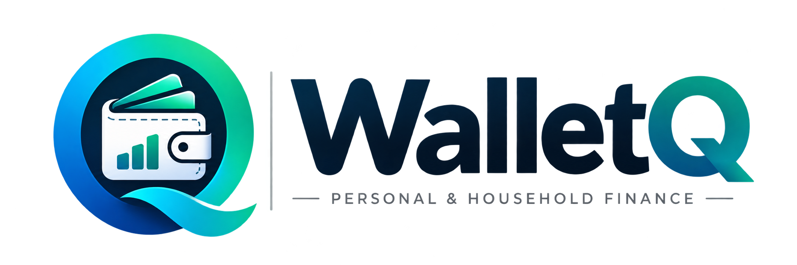
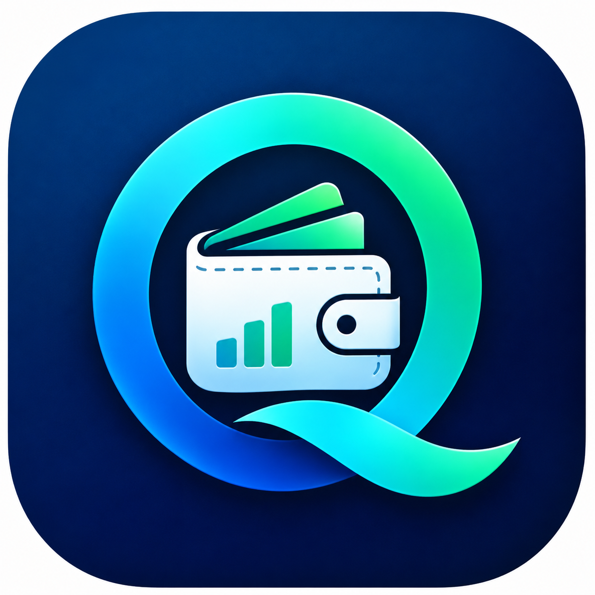

<div align="center">

  <a href="https://dr-subzero.github.io/"></a>

  

  <h1>WalletQ</h1>
  <h3>Personal finance. Household finance. Complete control.</h3>

  <p>
    A free and open-source Android app for managing personal and household finances.
    <br>
    Built with Kotlin and Jetpack Compose. Designed for privacy, accuracy, and offline use.
  </p>

  <p>
    
  </p>

  <p>
    <a href="https://github.com/Dr-SuBZeRo/WalletQ">
      
    </a>
    <a href="https://kotlinlang.org/">
      
    </a>
    <a href="https://developer.android.com/jetpack/compose">
      
    </a>
    <a href="https://www.apache.org/licenses/LICENSE-2.0">
      
    </a>
  </p>

  <p>
    <a href="#-about">About</a> &nbsp;•&nbsp;
    <a href="#-principles">Principles</a> &nbsp;•&nbsp;
    <a href="#-capabilities">Capabilities</a> &nbsp;•&nbsp;
    <a href="#-architecture">Architecture</a> &nbsp;•&nbsp;
    <a href="#-build">Build</a> &nbsp;•&nbsp;
    <a href="#-roadmap">Roadmap</a> &nbsp;•&nbsp;
    <a href="#-documentation">Documentation</a>
  </p>

  <p><strong>Free forever&nbsp; · &nbsp;Offline-first&nbsp; · &nbsp;Privacy-focused&nbsp; · &nbsp;Open source</strong></p>
</div>

---

## 💼 About

**WalletQ** is a privacy-focused personal and household money management application for Android, developed by **SuBZeRo**.

WalletQ is being built to help people organize their financial lives in one place: manage accounts, record income and expenses, track transfers, plan budgets, monitor savings, and understand their financial activity.

The project is designed around local data ownership. Essential finance workflows are intended to work without mandatory registration, cloud services, or a connection to a bank.

> **Your money. Your data. Your control.**

<div align="center">
  <table>
    <tr>
      <td align="center" width="25%">
        <h3>🔒</h3>
        <strong>Private by design</strong>
        <br><sub>No ads or tracking SDKs</sub>
      </td>
      <td align="center" width="25%">
        <h3>📴</h3>
        <strong>Offline-first</strong>
        <br><sub>Local-first finance workflows</sub>
      </td>
      <td align="center" width="25%">
        <h3>🧮</h3>
        <strong>Financial accuracy</strong>
        <br><sub>Precision-aware money model</sub>
      </td>
      <td align="center" width="25%">
        <h3>🆓</h3>
        <strong>Free and open</strong>
        <br><sub>No paid feature tiers</sub>
      </td>
    </tr>
  </table>
</div>

## ✨ Principles

<table>
  <tr>
    <td width="50%" valign="top">
      <h3>🔐 Privacy first</h3>
      No mandatory account, phone number, advertising SDK, analytics SDK, or financial tracking.
    </td>
    <td width="50%" valign="top">
      <h3>📡 Offline by default</h3>
      Core financial records and calculations are designed to work locally without internet access.
    </td>
  </tr>
  <tr>
    <td width="50%" valign="top">
      <h3>👨‍👩‍👧 Personal + household</h3>
      The data model supports personal profiles, households, member roles, and household-owned accounts.
    </td>
    <td width="50%" valign="top">
      <h3>💱 Multi-currency</h3>
      Accounts retain their currency. Conversions use explicit rates and currency-specific precision.
    </td>
  </tr>
  <tr>
    <td width="50%" valign="top">
      <h3>🧾 Data integrity</h3>
      Ledger-oriented accounting, checked arithmetic, explicit reversals, and non-destructive migrations.
    </td>
    <td width="50%" valign="top">
      <h3>📦 User-controlled data</h3>
      Local storage with planned standard and encrypted backup and restore workflows.
    </td>
  </tr>
</table>

## 🚀 Capabilities and development status

WalletQ is under active development. The project distinguishes implemented foundations from features that are still planned. A domain engine or data model does not mean the corresponding user-facing workflow is already available.

<details open>
  <summary><strong>✅ Implemented foundations</strong></summary>
  <br>

  - [x] Android project and Jetpack Compose application shell
  - [x] Material 3 theme foundation: System, Light, and Dark
  - [x] Five top-level destinations: Home, Activity, Accounts, Reports, and More
  - [x] Room database foundation, schema version 2
  - [x] Personal profile and first-class household data models
  - [x] Household membership and role model
  - [x] Account ownership model for personal and household accounts
  - [x] Currency metadata for INR, USD, EUR, GBP, AED, and JPY
  - [x] Historical exchange-rate data model
  - [x] Integer-minor-unit money model with currency-specific precision
  - [x] Checked money arithmetic and controlled decimal rounding
  - [x] Pure Kotlin ledger domain engine
  - [x] Income, expense, and transfer entry generation
  - [x] Domain-level reversal and replacement mechanics
  - [x] Ownership validation in the financial domain
  - [x] Unit tests for money, currency, ownership, navigation, and ledger rules
</details>

<details>
  <summary><strong>🛠️ Planned application features</strong></summary>
  <br>

  - [ ] Persistent transaction and ledger database tables
  - [ ] Add, view, search, and filter income and expenses
  - [ ] Account transfers, including cross-currency transfers
  - [ ] Account balance history and reconciliation
  - [ ] Custom income and expense categories
  - [ ] Personal and household finance workflows
  - [ ] Monthly budgets and spending limits
  - [ ] Savings goals
  - [ ] Recurring transactions and bill reminders
  - [ ] Financial reports and spending insights
  - [ ] Standard and encrypted local backup and restore
</details>

## 💱 Multi-currency model

WalletQ is designed to support multiple currencies from the beginning.

| Currency | ISO code | Minor-unit precision |
|---|:---:|:---:|
| Indian Rupee | INR | 2 |
| US Dollar | USD | 2 |
| Euro | EUR | 2 |
| British Pound | GBP | 2 |
| UAE Dirham | AED | 2 |
| Japanese Yen | JPY | 0 |

**Currency rules**

- INR is the default reporting currency.
- Each account retains its own currency.
- Amounts in different currencies are never added directly.
- Conversion requires an explicit exchange rate.
- The applied rate and converted amount are preserved for historical financial events.
- Rounding follows the destination currency's precision and documented rules.
- Live exchange-rate retrieval is not part of the current offline foundation.

## 🧾 Financial integrity

WalletQ uses a ledger-oriented financial domain model.

| Event | Account effect |
|---|---|
| Income | Positive ledger entry |
| Expense | Negative ledger entry |
| Same-currency transfer | Matching debit and credit |
| Cross-currency transfer | Source and destination entries in their respective currencies |
| Reversal | Compensating entries; original history retained |
| Replacement | Reversal of original followed by corrected transaction |

For a same-currency transfer, the source and destination movements must conserve value. Cross-currency entries are not compared as raw minor-unit values; the conversion relationship is recorded explicitly.

Financial amounts use integer minor units for storage and checked arithmetic for balance calculations. Decimal arithmetic is used where controlled exchange-rate calculations require it. Floating-point types are not used to represent money.

## 🧱 Architecture

WalletQ follows MVVM and Clean Architecture principles, with a local-first data layer.

<table>
  <tr>
    <th align="left">Layer</th>
    <th align="left">Responsibility</th>
  </tr>
  <tr>
    <td><strong>Presentation</strong></td>
    <td>Jetpack Compose screens, UI state, and ViewModels</td>
  </tr>
  <tr>
    <td><strong>Domain</strong></td>
    <td>Money models, currency rules, ledger engine, and financial validation</td>
  </tr>
  <tr>
    <td><strong>Data</strong></td>
    <td>Repositories, Room entities, DAOs, and DataStore</td>
  </tr>
  <tr>
    <td><strong>Platform</strong></td>
    <td>Android lifecycle, dependency injection, and background work</td>
  </tr>
</table>

### Technology stack

| Area | Technology |
|---|---|
| Platform | Android |
| Language | Kotlin |
| UI toolkit | Jetpack Compose |
| Design system | Material 3 |
| Architecture | MVVM + Clean Architecture principles |
| Database | Room / SQLite |
| Preferences | DataStore |
| Dependency injection | Hilt |
| Asynchronous programming | Kotlin Coroutines and Flow |
| Background work | WorkManager |
| Navigation | Navigation Compose |
| Serialization | Kotlin Serialization |
| Testing | JUnit and AndroidX Testing |

### Current project configuration

| Setting | Value |
|---|---|
| Application ID | `com.walletq` |
| Minimum SDK | 26 |
| Compile SDK | 36 |
| Target SDK | 36 |
| JDK | 17 |
| Gradle | 8.13 |
| Android Gradle Plugin | 8.8.2 |
| Kotlin | 2.0.21 |
| Room schema | Version 2 |

Dependency versions are centralized in `gradle/libs.versions.toml`.

## 🏗️ Build

### Requirements

- Windows, macOS, or Linux
- JDK 17
- Android SDK with the required platform and build tools
- Git

### Clone the repository

```bash
git clone https://github.com/Dr-SuBZeRo/WalletQ.git
cd WalletQ
```

### Build a debug APK

**Windows PowerShell**

```powershell
.\gradlew.bat assembleDebug
```

**macOS / Linux**

```bash
./gradlew assembleDebug
```

### Run unit tests

**Windows PowerShell**

```powershell
.\gradlew.bat testDebugUnitTest
```

**macOS / Linux**

```bash
./gradlew testDebugUnitTest
```

### Run Android lint

```powershell
.\gradlew.bat lintDebug
```

The debug APK is generated at:

```text
app/build/outputs/apk/debug/app-debug.apk
```

## 🗺️ Roadmap

Development is organized into small, testable milestones.

| Milestone | Scope | Status |
|---|---|---|
| Phase 1 | Project foundation, app shell, initial database | <strong>Complete</strong> |
| Foundation audit | Household relationships, currency safeguards, migration V2 | <strong>Complete</strong> |
| Phase 2A | Pure Kotlin financial ledger engine | <strong>Complete</strong> |
| Phase 2B | Room transaction persistence and repository layer | <strong>Next</strong> |
| Phase 2C | Transaction entry and activity UI | Planned |
| Phase 3 | Account management and reconciliation | Planned |
| Phase 4 | Dashboard and financial overview | Planned |
| Phase 5 | Categories and budgets | Planned |
| Phase 6 | Currency conversion management | Planned |
| Phase 7 | Household finance workflows | Planned |
| Phase 8 | Analytics and reports | Planned |
| Phase 9 | Savings goals and recurring transactions | Planned |
| Phase 10 | Standard and encrypted backup / restore | Planned |
| Release | Quality, accessibility, security, and release preparation | Planned |

Milestone status is updated as implementation is completed and verified. Planned features are not presented as released functionality.

## 🛡️ Privacy and permissions

WalletQ is designed to minimize data collection and external dependencies.

- The current Android manifest does not declare `android.permission.INTERNET`.
- No advertising or analytics SDKs are included in the current project.
- Financial records are stored in the application's local database.
- No mandatory account or cloud synchronization is required.
- Backup and restore are planned as explicit, user-controlled operations.

See [PRIVACY.md](docs/PRIVACY.md) for the privacy design and implementation notes.

## 📚 Documentation

| Document | Description |
|---|---|
| [Architecture](docs/ARCHITECTURE.md) | Application structure and architectural decisions |
| [Financial Rules](docs/FINANCIAL_RULES.md) | Money precision, accounting, and ledger rules |
| [Privacy](docs/PRIVACY.md) | Privacy principles and data handling |
| [Roadmap](docs/ROADMAP.md) | Development milestones |
| [Implementation Checklist](docs/IMPLEMENTATION_CHECKLIST.md) | Task-level implementation progress |
| [Contributing](CONTRIBUTING.md) | Development and contribution guidelines |

## 🤝 Contributing

Contributions, bug reports, and practical suggestions are welcome.

Before submitting changes:

1. Read the architecture and financial rules documentation.
2. Keep financial calculations deterministic and independently testable.
3. Add or update tests for behaviour changes.
4. Preserve user data through explicit database migrations.
5. Avoid dependencies that introduce tracking, advertisements, or unnecessary network access.
6. Keep pull requests focused and explain architectural decisions.

See [CONTRIBUTING.md](CONTRIBUTING.md) for development guidelines.

## 📄 License

WalletQ is distributed under the **Apache License 2.0**. See [LICENSE](LICENSE) for the complete license text.

## 👨‍💻 Developer

<div align="center">
  <h2>SuBZeRo</h2>
  <p>Independent developer · Open-source enthusiast</p>
  <a href="https://github.com/Dr-SuBZeRo">
    
  </a>
  <br><br>
  <strong>WalletQ — Your money. Your data. Your control.</strong>
  <br>
  <sub>Built with care by SuBZeRo.</sub>
</div>
